

<a href="https://rushikeshh.in"><picture><source media="(prefers-color-scheme: dark)" srcset="assets/neofetch/dark.svg" />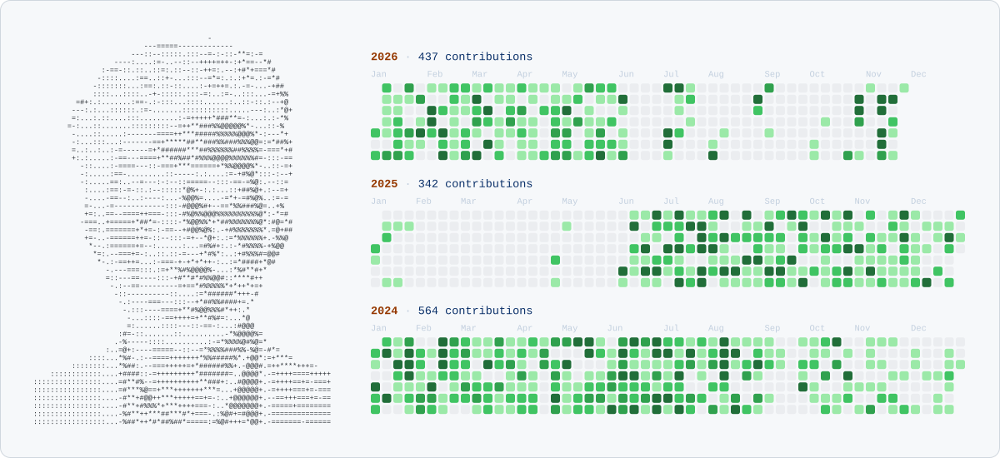</picture></a>

<a href="https://drive.google.com/file/d/1o3TzPZh0TLtcQsLNcLPoqlvmUMhlDAaG/view?usp=sharing"><picture><source media="(prefers-color-scheme: dark)" srcset="assets/dark/btn-resume.svg" /></picture></a>&nbsp;&nbsp;<a href="https://rushikeshh.in"><picture><source media="(prefers-color-scheme: dark)" srcset="assets/dark/btn-site.svg" /></picture></a>&nbsp;<a href="https://www.linkedin.com/in/rushikesh-chavan-275282211/"><picture><source media="(prefers-color-scheme: dark)" srcset="assets/dark/btn-linkedin.svg" /></picture></a>

  

<picture><source media="(prefers-color-scheme: dark)" srcset="assets/dark/stats.svg" /></picture>

   

<picture><source media="(prefers-color-scheme: dark)" srcset="assets/dark/h-expertise.svg" /></picture>

 

<picture><source media="(prefers-color-scheme: dark)" srcset="assets/dark/expertise.svg" /></picture>

   

<picture><source media="(prefers-color-scheme: dark)" srcset="assets/dark/h-work.svg" /></picture>

 

<a href="https://credisense-rushi.vercel.app/"><picture><source media="(prefers-color-scheme: dark)" srcset="assets/dark/credisense.svg" /></picture></a>

<a href="https://credisense-rushi.vercel.app/"><picture><source media="(prefers-color-scheme: dark)" srcset="assets/dark/btn-try.svg" /></picture></a>&nbsp;&nbsp;<a href="https://github.com/rushikeshchavan-7/CrediSense"><picture><source media="(prefers-color-scheme: dark)" srcset="assets/dark/btn-source.svg" /></picture></a>

 

&nbsp;

Screens from the running app. Borrowers and figures are fictional sample data.

  

<a href="https://github.com/rushikeshchavan-7/DocuMind"><picture><source media="(prefers-color-scheme: dark)" srcset="assets/dark/work-documind.svg" /></picture></a>&nbsp;<a href="https://github.com/rushikeshchavan-7/Cultivate"><picture><source media="(prefers-color-scheme: dark)" srcset="assets/dark/work-cultivate.svg" /></picture></a>

<a href="https://github.com/rushikeshchavan-7/StudyManager"><picture><source media="(prefers-color-scheme: dark)" srcset="assets/dark/work-karmakendra.svg" /></picture></a>&nbsp;<a href="https://github.com/rushikeshchavan-7/portfolio-angular"><picture><source media="(prefers-color-scheme: dark)" srcset="assets/dark/work-portfolio.svg" /></picture></a>

   

<picture><source media="(prefers-color-scheme: dark)" srcset="assets/dark/h-journey.svg" /></picture>

 

<picture><source media="(prefers-color-scheme: dark)" srcset="assets/dark/experience.svg" /></picture>

   

<picture><source media="(prefers-color-scheme: dark)" srcset="assets/dark/h-contact.svg" /></picture>

 

<a href="mailto:rushikeshchavan2002@gmail.com"><picture><source media="(prefers-color-scheme: dark)" srcset="assets/dark/btn-email.svg" /></picture></a>&nbsp;&nbsp;<a href="https://rushikeshh.in"><picture><source media="(prefers-color-scheme: dark)" srcset="assets/dark/btn-site.svg" /></picture></a>&nbsp;<a href="https://www.linkedin.com/in/rushikesh-chavan-275282211/"><picture><source media="(prefers-color-scheme: dark)" srcset="assets/dark/btn-linkedin.svg" /></picture></a>

